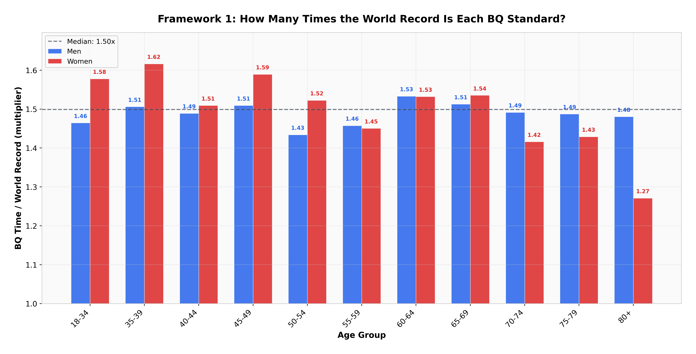
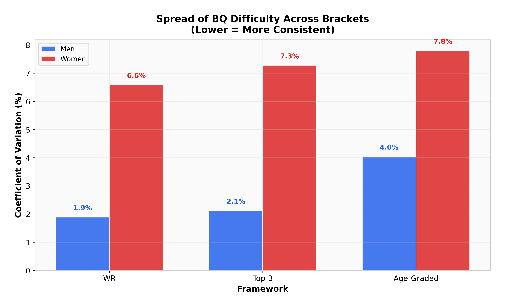
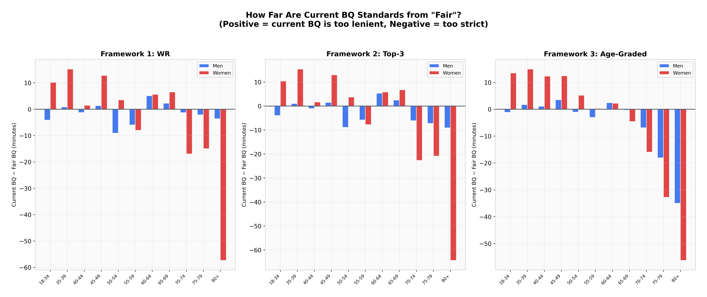
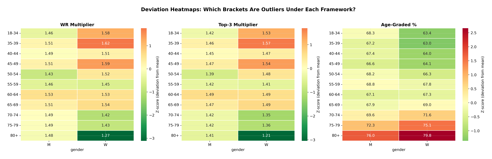
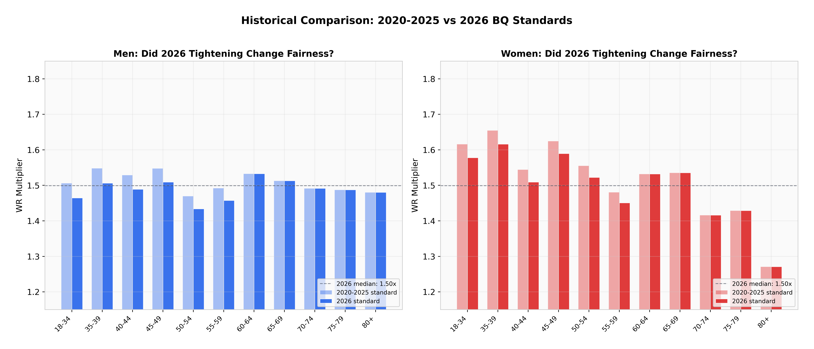
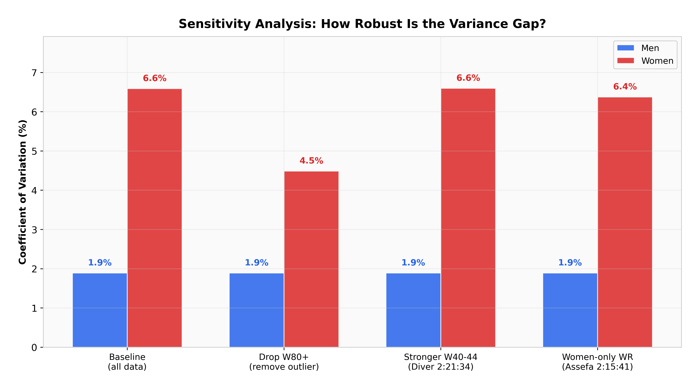

# Are Boston Marathon qualifying times fair?

**A three-framework analysis of the 2026 qualifying standards by age and gender**

*Jeremy Lee · May 2026 · [github.com/lyhjeremy/boston-marathon-qualifying-fairness](https://github.com/lyhjeremy/boston-marathon-qualifying-fairness)*

> The same content as the [PDF report](reports/Are_Boston_Marathon_Qualifying_Times_Fair_Report.pdf) and [Word version](reports/Are_Boston_Marathon_Qualifying_Times_Fair_Report.docx), formatted for GitHub. The [notebook](notebooks/boston_bq_fairness_analysis.ipynb) reproduces every number and figure.

## Abstract

The Boston Athletic Association sets qualifying times by age and gender and has never published how. This report tests whether the 2026 standards ask for equal difficulty across all 22 age-gender brackets, using three frameworks: (1) a world-record multiplier, (2) an averaged top-three-records check, and (3) WMA age grading. Under every framework the men's standards are consistent (coefficient of variation 1.9% to 4.0%) and the women's are not (6.6% to 7.8%). A Welch t-test finds no difference in the gender means (p = 0.81 under the world-record framework, p = 0.68 under age grading). W80+ is the most miscalibrated bracket under every framework. The report gives alternative standards under each framework and sets out the limitations.

## 1. Introduction

The Boston Marathon, first run in 1897, is the oldest annual marathon in the world and one of the few large marathons that requires a qualifying time. The BAA publishes standards for 11 age groups in each of two genders, plus a non-binary category added recently. For 2026 it cut five minutes from every standard below age 60 after 33,249 applications for roughly 24,000 qualifier places.

The BAA has not explained the method behind its standards. Its statements refer to "careful analysis of results data" without saying whether the aim is equal difficulty, equal selectivity, a target field size or continuity.

Here "equitable" means that every bracket requires the same proportional effort against a shared reference. Choosing the reference is itself a judgment, so the report uses three and compares them.

## 2. Data

The 2026 standards come from baa.org. The open marathon records (men: Sabastian Sawe, 1:59:30, London 2026; women, mixed race: Ruth Chepngetich, 2:09:56, Chicago 2024) were checked against World Athletics. Masters records from M40 to W80+ come from the Wikipedia list of masters road-running records, checked against WMA records. Age factors are the WMA 2023 Appendix B marathon factors, taken at each bracket's midpoint age (37 for 35-39, 82 for 80+). Field-size figures (33,249 applications, 24,362 accepted, a 4:34 cutoff) come from BAA press releases.

Scope: 22 brackets (11 age groups × 2 genders). Non-binary athletes (110 accepted in 2026) are excluded because the BAA says it does not have enough data to set standards for the category.

The four datasets are in [`data/`](data/).

## 3. Method

### 3.1 Framework 1: world-record multiplier

For each bracket:

```
multiplier = BQ_time / world_record_time
```

Under uniform difficulty every bracket would share one multiplier. Below age 40 there is no separate masters record, so the open record is the reference for 18-34 and 35-39. That makes 35-39 look more lenient than it may be.

### 3.2 Framework 2: top-three records

A single record is sensitive to one exceptional athlete. This framework replaces it with an average of the top three performances in each bracket. The second and third marks are estimated rather than looked up: 3% and 6% slower than the record for brackets with depth, and 5% and 10% slower for the thin 70+ brackets. It is an approximation and is labeled as one throughout.

### 3.3 Framework 3: WMA age grading

World Masters Athletics publishes age factors for the expected decline in performance with age. The age-adjusted standard for a bracket is the open record divided by its factor, and the age-graded percentage is that standard as a share of the BQ time:

```
age_graded_% = (open_WR / WMA_factor) / BQ_time × 100
```

This uses population-level factors instead of one athlete's record.

### 3.4 Tests

Gender means are compared with a Welch t-test and gender variances with Levene's test. Consistency across brackets is summarized by the coefficient of variation (CV). A uniform "fair" standard applies the median multiplier, or the median age-graded percentage, to every bracket.

## 4. Results

### 4.1 Framework 1: world-record multiplier

The median multiplier across all 22 brackets is **1.50×**: the typical standard is half again as slow as the bracket's record. The men's brackets fall between 1.43× and 1.53× (CV 1.9%). The women's run from 1.27× to 1.62× (CV 6.6%). The Welch t-test on gender means gives t = −0.25, p = 0.81. Levene's test gives W = 5.04, p = 0.036.



*Figure 1. BQ time as a multiple of the world record, by bracket. The dashed line is the median (1.50×).*

The extreme cases are W80+ at 1.27×, only 27% slower than Yoko Nakano's 4:11:45 record, and W35-39 at 1.62×, the most lenient bracket against its reference. The 0.35 gap between them is the core of the inconsistency in the women's standards.

### 4.2 Framework 2: top-three records

Averaging the estimated top three lowers the median multiplier to 1.45×. It does not reduce the spread: the women's CV is 7.3% and the men's 2.1%. The inconsistency is not the product of a single record.

### 4.3 Framework 3: age grading

Under WMA age grading the median standard asks for **67.9%** of age-graded potential. The men's brackets average 69.1% (CV 4.0%) and the women's 68.3% (CV 7.8%). The Welch t-test gives t = 0.42, p = 0.68. Age grading also shows the oldest brackets (75-79 and 80+) as harder than the record-based frameworks do, because the WMA factors expect a steeper decline with age than the standards allow for.



*Figure 2. Coefficient of variation by framework. The women's CV is about 3.5 times the men's under the two record-based frameworks and about twice under age grading.*



*Figure 3. Current standard minus the uniform standard, in minutes. Positive means the current standard is lenient, negative that it is strict.*

## 5. Findings across frameworks

**No mean-level gender bias.** Under each framework the average difficulty for men and women is statistically indistinguishable (p ≥ 0.68).

**The women's standards are less consistent.** The men's CV ranges from 1.9% to 4.0% across frameworks and the women's from 6.6% to 7.8%. Some of this comes from unusual reference records, and some from setting standards for brackets with thin competition.

**W80+ is the most miscalibrated bracket.** Under the world-record framework the current standard is **57 minutes** stricter than a uniform multiplier would set it. Under age grading it is **56 minutes** stricter. Whichever framework you prefer, the W80+ standard comes out too hard.



*Figure 4. Z-score deviation heatmaps. Red is harder than average, green easier. W80+ is red under every framework.*

## 6. The 2026 tightening

The 2026 race brought the largest single tightening since 1990: five minutes for every bracket under 60. The question here is whether it changed the consistency across brackets as well as the overall level.



*Figure 5. 2020-2025 standards (light) against 2026 (dark), as multiples of the current world records.*

The cut lowered every under-60 multiplier by about the same proportion and left the 60+ brackets alone. Measured against the same records, the women's CV was 7.3% under the 2020-2025 standards and is 6.6% in 2026; the men's moved from 1.8% to 1.9%. The change responded to demand and left the gap between men and women in place.

It also made the step between 55-59 and 60-64 steeper. For men it grew from 15 minutes (3:35 to 3:50) to 20 (3:30 to 3:50), and the women's step grew the same way.

## 7. Sensitivity analysis

The variance finding was re-run under three alternative scenarios:

- A: drop W80+ entirely.
- B: use Sinead Diver's 2:21:34 as the W40-44 reference.
- C: use Tigst Assefa's women-only record (2:15:41) for W18-34 in place of the mixed-race record.



*Figure 6. Coefficient of variation under each scenario. The men's CV is 1.9% throughout.*

The men's CV stays at 1.9% in every scenario, so there is no comparable outlier among the men's brackets. The women's CV falls to 4.5% only when W80+ is removed; Diver's record leaves it at 6.6% and Assefa's moves it to 6.4%. The variance gap does not depend on which records are used, and even without W80+ the women's CV is more than twice the men's.

## 8. All 22 brackets

Each bracket's metric under each framework, with the uniform standard under Frameworks 1 and 3. A current standard faster than the fair value is stricter than the median bracket; a slower one is more lenient.

| Age group | Sex | Current BQ | WR mult. | Top-3 mult. | AG % | Fair BQ (WR) | Fair BQ (AG) |
|:---------:|:---:|:----------:|:-------:|:----------:|:----:|:------------:|:------------:|
| 18-34 | M | 2:55:00 | 1.464 | 1.422 | 68.3 | 2:59:07 | 2:56:08 |
| 18-34 | W | 3:25:00 | 1.578 | 1.532 | 63.4 | 3:14:45 | 3:11:30 |
| 35-39 | M | 3:00:00 | 1.506 | 1.462 | 67.2 | 2:59:07 | 2:58:16 |
| 35-39 | W | 3:30:00 | 1.616 | 1.569 | 63.0 | 3:14:45 | 3:15:01 |
| 40-44 | M | 3:05:00 | 1.489 | 1.446 | 67.4 | 3:06:14 | 3:03:51 |
| 40-44 | W | 3:35:00 | 1.509 | 1.465 | 64.0 | 3:33:31 | 3:22:39 |
| 45-49 | M | 3:15:00 | 1.509 | 1.465 | 66.6 | 3:13:39 | 3:11:27 |
| 45-49 | W | 3:45:00 | 1.589 | 1.543 | 64.1 | 3:32:11 | 3:32:33 |
| 50-54 | M | 3:20:00 | 1.434 | 1.392 | 68.2 | 3:29:04 | 3:21:04 |
| 50-54 | W | 3:50:00 | 1.522 | 1.478 | 66.3 | 3:46:27 | 3:44:46 |
| 55-59 | M | 3:30:00 | 1.457 | 1.415 | 68.8 | 3:35:58 | 3:32:58 |
| 55-59 | W | 4:00:00 | 1.451 | 1.408 | 67.8 | 4:07:59 | 3:59:41 |
| 60-64 | M | 3:50:00 | 1.533 | 1.488 | 67.1 | 3:44:53 | 3:47:33 |
| 60-64 | W | 4:20:00 | 1.532 | 1.487 | 67.3 | 4:14:23 | 4:17:45 |
| 65-69 | M | 4:05:00 | 1.513 | 1.469 | 67.9 | 4:02:44 | 4:05:18 |
| 65-69 | W | 4:35:00 | 1.535 | 1.491 | 69.0 | 4:28:27 | 4:39:34 |
| 70-74 | M | 4:20:00 | 1.492 | 1.421 | 69.6 | 4:21:17 | 4:26:52 |
| 70-74 | W | 4:50:00 | 1.416 | 1.349 | 71.6 | 5:06:58 | 5:05:55 |
| 75-79 | M | 4:35:00 | 1.487 | 1.417 | 72.3 | 4:37:07 | 4:53:04 |
| 75-79 | W | 5:05:00 | 1.429 | 1.361 | 75.1 | 5:19:56 | 5:37:46 |
| 80+ | M | 4:50:00 | 1.480 | 1.410 | 76.0 | 4:53:38 | 5:24:58 |
| 80+ | W | 5:20:00 | 1.271 | 1.211 | 79.8 | 6:17:20 | 6:16:15 |

*Table 1. Current BQ is the 2026 BAA standard. The multipliers are BQ time divided by the reference time. AG % is the age-graded percentage. The fair columns apply the median multiplier (1.50×) or the median AG % (67.9%) to every bracket. For W80+ the current standard is 5:20:00 and the fair standard under Framework 1 is 6:17:20, a 57-minute gap.*

## 9. Limitations

**Single-record dependence.** Frameworks 1 and 2 rest on individual performances, and thin brackets, older women's in particular, are set by one exceptional athlete. Framework 3 avoids this with population-level factors, though those factors come from historical data that may underrepresent some groups.

**Brackets under 40.** With no separate masters record below 40, 18-34 and 35-39 share the open record, which makes 35-39 look more lenient than it may be.

**Top-three estimates.** Framework 2 uses fixed depth factors instead of actual second and third marks.

**One definition of fairness.** These frameworks measure equal difficulty only. The BAA may be aiming at field size, continuity, participation or competitive depth, and a standard that looks unfair under one definition may be reasonable under another.

**Statistical power.** With 11 brackets per gender the tests have little power. Levene's p = 0.036 is from the world-record framework only and clears 0.05 narrowly.

## 10. Conclusion

On average the BAA's standards treat men and women alike. The claim that Boston is unfair to women does not survive testing under any of the three frameworks. What the data does show is a consistency problem: the women's standards vary much more from bracket to bracket than the men's, and W80+ is an outlier under every framework.

The choice of framework is a trade-off. World records are transparent and sensitive to outliers; top-three averages are steadier but partly estimated; age grading rests on population data with its assumptions inside the factor tables. None is correct by default, so the report shows what each one finds.

## Reproducibility

| Path | Contents |
|---|---|
| [`notebooks/boston_bq_fairness_analysis.ipynb`](notebooks/boston_bq_fairness_analysis.ipynb) | Notebook that reproduces every number and figure |
| [`data/`](data/) | The four source CSVs |
| [`outputs/figures/`](outputs/figures/) | All eight figures at 400 DPI |
| [`outputs/analysis_results.csv`](outputs/analysis_results.csv) | Results table, 22 brackets × 20 metrics |
| [`reports/`](reports/) | PDF and Word versions |
| [`src/analysis.py`](src/analysis.py) | Script that regenerates every figure and the results CSV |

```bash
git clone https://github.com/lyhjeremy/boston-marathon-qualifying-fairness.git
cd boston-marathon-qualifying-fairness
pip install -r requirements.txt
python src/analysis.py
```

*© 2026 Jeremy Lee · MIT License · Data current as of May 2026*
